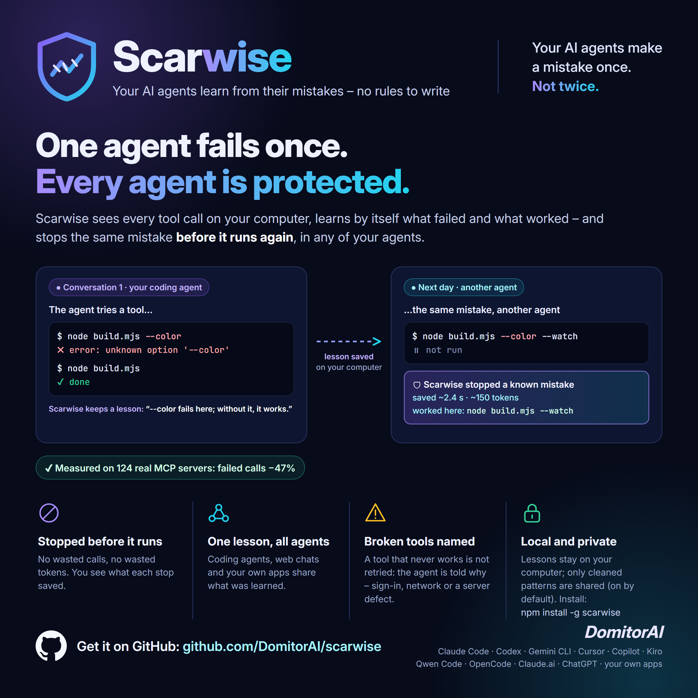

<p align="center">
  
</p>

<h1 align="center">Scarwise</h1>

<p align="center"><b>Wise from scars.</b><br>No rules to write – it learns by itself.</p>

> **Public beta.** Scarwise is in active testing: we are measuring it on public benchmarks and fixing what we find, so expect frequent updates. Found a problem or have an idea? Tell us in [Discussions](https://github.com/DomitorAI/scarwise/discussions).

## YOUR AGENTS MAKE A MISTAKE ONCE. NOT TWICE.

**A safety layer between your AI agents and their tools.**
AI agents call tools all day: they run commands, read files, call MCP servers.
When a call fails, the agent finds a form that works – and forgets it by the next conversation.
Tomorrow it makes the same mistake again. So does every other agent on your computer.

Scarwise remembers the mistakes made on your computer. When an agent is about to repeat one, the call is stopped before it runs and the agent is told what worked here.

### Why

- **No rules to write.** Scarwise learns by itself from what failed and what then worked. You do not write or maintain any rules.
- **No wasted calls, no wasted tokens.** A mistake already made is stopped before it runs. You see what it saved: `🛡 Scarwise stopped a known mistake (a line break inside a single command) · saved ~2.4 s · ~150 tokens`.
- **One lesson protects every agent.** A mistake one of your agents made with a tool is not repeated by your other agents – a web chat, a coding agent in the terminal, your own application – when they use the same tool.
- **Tools that do not work are recognized.** When a tool of an MCP server has never worked on your computer, the agent is told so after its first failed try, with the likely cause – a missing key or sign-in, a service that does not answer, a defect of the server – instead of retrying again and again. A server repaired in the meantime is not left blocked.
- **Rate limits respected.** A service that answered "too many requests" is not called again before the wait ends.
- **Nothing to configure.** `npm install -g scarwise` finds your agents and connects to each of them; `npm uninstall -g scarwise` leaves nothing behind.
- **Your computer, your data.** What Scarwise learns stays on your computer; only cleaned general patterns go to the shared library (**ON BY DEFAULT**, off: `scarwise share off`). See [Privacy](#privacy).

## Works with

| Your agent | How Scarwise connects | Status |
|---|---|---|
| **Claude.ai**, **ChatGPT** (MCP connectors) | `scarwise proxy` in front of your MCP server | verified |
| **Qwen Code** | hooks, added at install | verified |
| **OpenCode** | plugin + local MCP servers through Scarwise, added at install | verified |
| **Claude Code**, **Codex CLI**, **Gemini CLI**, **Cursor**, **Copilot CLI**, **Kiro CLI** | hooks, added at install | automated tests; real use in the beta |
| an agent without hooks | `scarwise run -- <agent>`: its shell commands go through Scarwise | automated tests |
| **your own application** (JavaScript/TypeScript, Python) | the SDK (`guard`, `@guard`), or `scarwise api` in front of the Anthropic or OpenAI API | automated tests |

Windows, macOS and Linux. Node.js 22 or newer.

What is not supported yet is listed in [Limits](docs/limits.md).

## Measured

### On real MCP servers

Servers from the official MCP registry. Each test is the same task in 3 new conversations with one server: in conversations 1 and 2 Scarwise only watched, in conversation 3 it was active. **Without** = conversation 2, **with** = conversation 3 – both come after the same mistakes of conversation 1.

| | Qwen Code | OpenCode | Both |
|---|---|---|---|
| MCP servers | 116 | 121 | **124** different servers |
| Tests (one server, 3 conversations) | 125 | 127 | 252 |
| …tests where calls failed | 63 | 60 | 123 |
| **Failed calls**, without → with | 400 → 216 (−46%) | 467 → 243 (−48%) | **867 → 459 (−47%)** |
| **Same mistake repeated**, without → with | 267 → 149 (−44%) | 286 → 149 (−48%) | **553 → 298 (−46%)** |
| Calls stopped before they ran | 50 | 58 | 108 |
| **Tokens** the agent read from failed calls, without → with | ~55,600 → ~32,700 (−41%) | ~26,400 → ~17,200 (−35%) | **~82,000 → ~49,900 (−39%)** |

<sub>Tokens are counted only from the error messages the agent read; the agent's own reasoning about each error is not counted, so the real saving is larger. Most servers were tested with both agents, some in more than one round. Of the 200 most popular servers in the registry, 96 started without an account or a key; the others stopped at start (mostly a missing key) or did not answer.</sub>

### In chat apps and coding agents

The same task in 2 new conversations without Scarwise and 2 with it; the numbers are the **average per conversation**.

The agents below are the ones we measured; what one agent learns about a tool applies to your other agents too.

| Agent | Failed calls per conversation, without → with | Same mistake repeated per conversation, without → with |
|---|---|---|
| ChatGPT (MCP connector) | 3.5 → 0.5 | 3 → 0 |
| Claude.ai (MCP connector) | 3.5 → 0 | 2.5 → 0 |
| OpenCode | 3 → 1.5 | 3 → 1 |

<sub>Example: "3.5 → 0.5" = on average 3.5 failed calls in a conversation without Scarwise, 0.5 with it.</sub>

<sub>**These numbers will change as testing continues:** the tests on real servers are still running, each new version of Scarwise is measured again, and the beta will add numbers from other computers. Measured on Windows, October 2026.</sub>

## How it works

```
 Your agent                    Scarwise (on your computer)                 The tool
 ┌──────────────┐  tool call  ┌──────────────────────────────────┐  call  ┌───────────────────┐
 │ chat, coding │ ──────────▶ │ a known mistake?  stop + explain │ ─────▶ │ shell, files,     │
 │ agent, app   │ ◀────────── │ result: learn from what happened │ ◀───── │ MCP server, API   │
 └──────────────┘   result    └──────────────────────────────────┘ result └───────────────────┘
```

- Scarwise sees each tool call before it runs and its result after.
- When a call fails and the agent then succeeds another way, Scarwise keeps a **lesson**.
- Next time, in any agent, the same mistake is stopped before it runs. The agent gets the explanation and goes on the right way.
- **New lessons are careful:** they only stop and explain. A lesson that turns out wrong is dropped.
- If anything inside Scarwise fails, the call goes through unchanged.
- Every time an agent starts, you see one line: `🛡 Protected by Scarwise`. It is shown to you only, never added to the agent's context. Turn it off with `scarwise config level quiet`.

`scarwise lessons` shows what was learned and why. `scarwise forget <id>` removes a lesson.

## Privacy

What Scarwise learns stays on your computer, in `~/.scarwise`.

| May leave your computer | Never leaves it |
|---|---|
| the **name** of an agent Scarwise does not support yet – **ON BY DEFAULT**, off with `scarwise telemetry off` | your tool calls, files, prompts and answers |
| **lessons for the shared library – ON BY DEFAULT**, off with `scarwise share off`: general mistake patterns already proven on your computer, cleaned of paths, user names, secrets and whole commands | lessons about your private MCP servers |
| a diagnostic file – only when you run `scarwise report` and send it yourself | lessons you received from the library (never sent back) |

Every new version ships the shared library: your agents start with mistakes other users have already met. Those lessons apply only to the MCP servers you actually use, and they only stop and explain.

Details: [Privacy](docs/privacy.md).

### Safe by design

- **It changes agent settings only when installed, reconnected or removed** (`npm install -g`, `scarwise init`, `install`, `uninstall`, `npm uninstall -g`), with a backup of every file, and only its own entries.
- **It never runs the calls it sees.** It lets them through or stops them; it corrects one only with a lesson already proven on your computer.
- **Lessons from files and from the shared library are treated as untrusted.**
- **It never updates itself.** While a new version exists, every start of an agent says so; `scarwise update` installs it when you decide.

## Requirements

- **Node.js 22 or newer** ([nodejs.org](https://nodejs.org)).
- At least one AI agent: any agent in [Works with](#works-with).
- For Claude.ai and ChatGPT: an MCP server reachable from the internet (for example through a Cloudflare Tunnel).

## Quick start

```
npm install -g scarwise
```

That is the only step. The install finds the agents on your computer, connects Scarwise to each of them and tests every connection. Start a new session of each agent afterwards. Installed a new agent later? Run `scarwise init`. All commands: `scarwise --help`.

> **SHARING IS ON BY DEFAULT.** Scarwise sends the shared library general mistake patterns already proven on your computer (cleaned: no paths, user names, secrets or whole commands), and the names of agents it does not support yet. **To turn it off:** `scarwise share off` and `scarwise telemetry off`. Details: [Privacy](docs/privacy.md).

Codex asks you once to trust new hooks: open `/hooks` in Codex and trust the Scarwise ones.

**Claude.ai and ChatGPT** reach your MCP server through a public address. Put Scarwise in front of it, and point the tunnel to Scarwise:

```
scarwise proxy --listen 8080 --upstream http://127.0.0.1:9080 --name myserver
```

**Your own application:**

```js
import { guard } from 'scarwise/sdk';
const runQuery = guard('db.query', async ({ sql }) => db.query(sql));
await runQuery({ sql: 'select 1' });   // a known mistake throws ScarwiseStop with the explanation
```

```python
from scarwise import guard

@guard("db.query")
def run_query(sql): ...
```

## Documentation

| Guide | What is in it |
|---|---|
| [The `scarwise` command](docs/cli.md) | all commands, with examples |
| [Agents](docs/agents.md) | what `init` does for each agent, web chats, agents without hooks, your own applications |
| [Privacy](docs/privacy.md) | what may leave your computer, how it is cleaned, how to turn it off |
| [Limits](docs/limits.md) | what is not supported yet |

## Updating

When a newer version is out, Scarwise tells you every time an agent starts: `🛡 Protected by Scarwise · 0.1.2 is available: scarwise update`. It checks for one at most once a day.

```
scarwise update
```

It installs the latest version and reconnects your agents. Your lessons are kept. Nothing is updated without you.

## Uninstall

```
npm uninstall -g scarwise
```

The next time each agent starts, every trace of Scarwise is removed by itself: its hooks, the OpenCode plugin, the MCP servers it wrapped (back to their own command), its backups and `~/.scarwise` with the lessons. Nothing of yours is touched.

To disconnect Scarwise from your agents but keep it installed (and keep your lessons): `scarwise uninstall`.

## Feedback and custom development

- **Bug or feature request:** [open an issue](https://github.com/DomitorAI/scarwise/issues/new/choose). For a problem, attach the file made by `scarwise report` (check it first).
- **Question, idea or opinion:** [Discussions](https://github.com/DomitorAI/scarwise/discussions).
- **Security vulnerability:** [report it privately](https://github.com/DomitorAI/scarwise/security/advisories/new), never in a public issue. See [SECURITY.md](SECURITY.md).
- Liked it? A ⭐ on the repository helps others find it.

Do you need a permission the license does not cover?
Or a version made for your agents, your tools, your infrastructure?
[Open a **Contact request**](https://github.com/DomitorAI/scarwise/issues/new?template=contact_request.yml).
Don't write project details there, because issues are public. You will get a reply on how to continue privately.

## License

Free to use without limits, also commercially: on any number of computers, with any number of agents.
You may ship the SDK, unmodified, inside your own application, also one you sell.
Selling Scarwise itself, or offering it as a paid hosted service, needs the author's permission.
Provided as is, without warranty. Whether and how you use it is your decision.
See [LICENSE](LICENSE).

## About

Made by [**DomitorAI**](https://github.com/DomitorAI) — Svatantra Dev (स्वतन्त्र).
